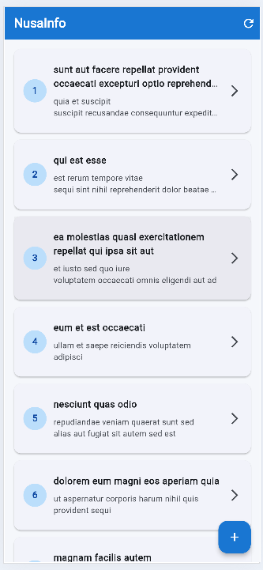
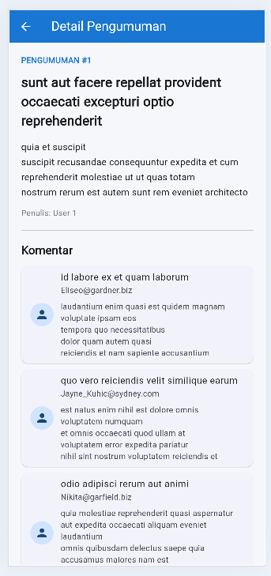
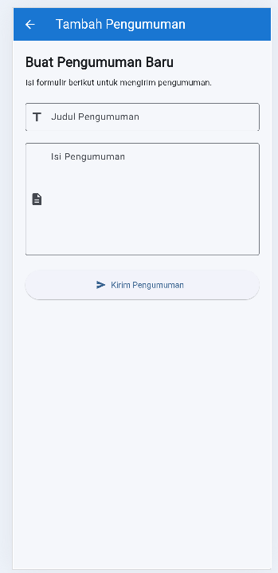
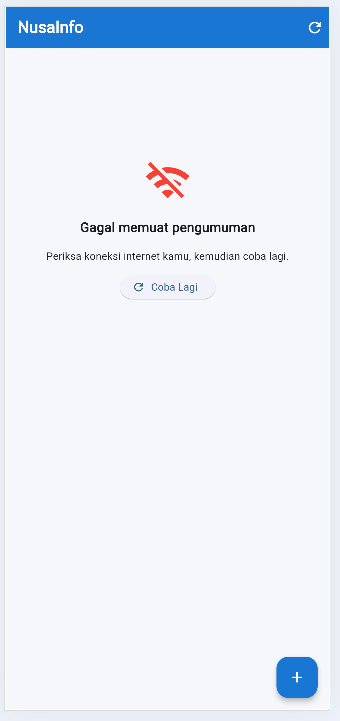
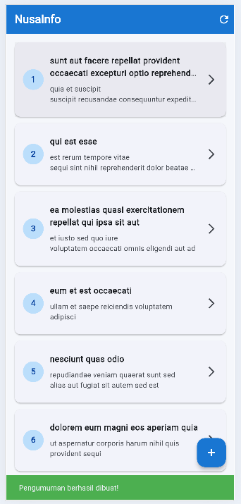

# NusaInfo

Aplikasi informasi dan pengumuman berbasis Flutter
yang mengambil data dari JSONPlaceholder API.

## Fitur
- Menampilkan daftar pengumuman.
- Melihat detail pengumuman.
- Menampilkan komentar.
- Menambahkan pengumuman.
- Validasi formulir.
- Loading dan error handling.
- Refresh data menggunakan RefreshIndicator.

## Teknologi
- Flutter
- Dart
- HTTP Package
- JSONPlaceholder API

## Screenshot Aplikasi

### 1. Home Screen

### 2. Detail Screen

### 3. Add Post Screen

### 4. Error Internet

### 5. SnackBar Berhasil

